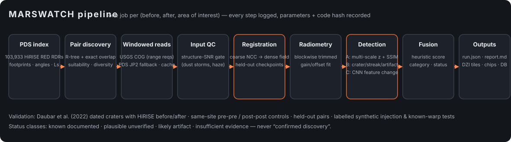

# MARSWATCH — Autonomous Mars Surface Change Detection

MARSWATCH searches public NASA **HiRISE** orbital imagery for surface changes between repeat
observations: new impact craters, slope streaks, dune/bedform motion, rockfalls, seasonal changes
and other anomalies. It discovers overlapping multi-temporal image pairs from the PDS index,
streams only the needed pixels from cloud-optimized archives, co-registers the images with verified
sub-pixel accuracy, detects changes with three complementary methods, filters artifacts, ranks
candidates, and presents the evidence in a web dashboard.

> **Candidates are not discoveries.** Every output is a candidate with explicit evidence for and
> against. Read [docs/LIMITATIONS.md](docs/LIMITATIONS.md) and the measured
> [validation results](docs/VALIDATION_RESULTS.md) before interpreting anything.



## What is real here

* **Data**: 103,933 HiRISE RED RDRs indexed from the PDS cumulative index
  (`hirise-pds.lpl.arizona.edu`), imagery streamed from USGS Astrogeology's analysis-ready COGs
  (doi:10.5066/P944DLP8) with the PDS JPEG2000 originals as fallback. No synthetic imagery is used
  in place of missing data. Synthetic perturbations appear only in clearly labelled tests.
* **Ground truth**: Daubar et al. (2022), *New Craters on Mars: An Updated Catalog*, JGR Planets
  (1,203 dated impacts, Zenodo 6604912). 19 of them have HiRISE coverage both before and after
  formation; they form the validation set, together with same-site negative controls.
* **Validation**: recall, false positives per km², precision (with a stated assumption),
  registration accuracy (held-out checkpoints + known synthetic warps), sensitivity vs size, and
  throughput are all produced by `marswatch validate` and written to
  [docs/VALIDATION_RESULTS.md](docs/VALIDATION_RESULTS.md).

## Quick start (Apple Silicon Mac mini, macOS)

Requirements: Python ≥ 3.11, Node ≥ 18, ~3 GB free disk (index DB ≈ 100 MB, cache budget 2 GB by default).

```bash
git clone <this repo> marswatch && cd marswatch
```

```bash
python3 -m venv .venv && source .venv/bin/activate
```

```bash
pip install -e ".[dev]"            # core: numpy, opencv, scikit-image, rasterio (bundles GDAL), fastapi…
```

```bash
pip install -e ".[ml]"             # optional Method C (PyTorch; uses Apple 'mps' GPU automatically)
```

```bash
marswatch init                     # downloads + ingests the HiRISE index (~170 MB) and the Daubar catalog
```

```bash
cd frontend && npm install && npm run build && cd ..
```

```bash
MARSWATCH_EMBED_WORKER=1 marswatch serve --port 8000    # dashboard at http://127.0.0.1:8000
```

## Command line

```bash
marswatch covering 17.762 226.942                       # HiRISE observations covering a point
```

```bash
marswatch analyze PSP_007168_1980_RED ESP_056155_1980_RED --lat 17.762 --lon 226.942 --half 400 --res 0.5
```

```bash
marswatch discover --region lycus --lat0 24 --lat1 30 --lon0 218 --lon1 228 --enqueue 10 --res 1.0 --max-area 12
```

```bash
marswatch worker --until-empty                          # process the queue (pause/resume via `marswatch pause|resume`)
```

```bash
marswatch validate                                      # documented-crater validation (tuning set)
```

```bash
marswatch validate --set holdout                        # held-out image pairs
```

```bash
marswatch validate --skip-craters --registration --injection   # synthetic registration + sensitivity tests
```

```bash
marswatch report --region lycus-sulci                   # docs/SURVEY_REPORT.md
```

```bash
pytest -m "not network"                                 # offline tests; `pytest -m network` hits the real archives
```

## Configuration (environment variables)

| Variable | Default | Meaning |
|---|---|---|
| `MARSWATCH_DATA_DIR` | `./data` | database, cache, run outputs |
| `MARSWATCH_CACHE_BUDGET_MB` | 2048 | LRU cache size limit for resampled imagery |
| `MARSWATCH_MAX_WORKERS` | 2 | worker threads |
| `MARSWATCH_MEMORY_LIMIT_MB` | 4096 | worker waits while process RSS exceeds this |
| `MARSWATCH_REQUESTS_PER_SECOND` | 4 | remote read rate limit |
| `MARSWATCH_WORK_RES_M` | 1.0 | default analysis resolution (m/px) |
| `MARSWATCH_MAX_PAIR_AREA_KM2` | 40 | largest overlap analysed per pair (centre crop beyond) |
| `MARSWATCH_GDAL_CACHE_MB` | 256 | GDAL block cache |
| `MARSWATCH_EMBED_WORKER` | unset | `1` runs the worker inside the API server |

## Dashboard

| Page | Purpose |
|---|---|
| **Mission Control** | pairs analysed, area inspected, candidates by status/category, validation operating points, processing status |
| **Mars Explorer** | Leaflet map (NASA Trek Viking/MOLA basemaps) with analysed areas, candidates and catalogued craters; click for HiRISE coverage; select a region to discover and queue pairs |
| **Before / After** | OpenSeadragon deep-zoom viewer: draggable slider, side-by-side (synced), blink; heatmap opacity, detection outlines, candidate boxes; observation and registration metadata |
| **Candidates** | searchable, sortable, filterable catalogue with evidence chips; CSV/JSON export |
| **Candidate detail** | chips, measurements, evidence for/against, validation checks, original observations (PDS/COG/HiRISE links), other coverage, processing history, registration diagnostics, reviewer notes/status, Markdown report export |
| **Validation** | operating points, sensitivity vs diameter, synthetic injection heatmap, registration tests, per-site results |
| **Processing Console** | job queue with progress/retry/cancel, pause/resume, CPU/RAM/disk/cache, remote-read statistics, live log |

## Repository layout

```
marswatch/
  archive/pds_index.py     PDS cumulative index → SQLite + R-tree
  archive/reference.py     Daubar et al. (2022) catalogue loader, proximity queries
  discovery.py             overlapping-pair discovery, suitability scoring, diverse selection
  geometry.py              Mars sphere footprints, local LAEA projections, areas
  imagery.py               COG/JP2 windowed reads → analysis grid, cache, input QC
  registration.py          coarse NCC + dense patch field + held-out checkpoint diagnostics
  align.py                 pair alignment orchestration
  normalize.py             blockwise robust radiometric matching
  detect/classical.py      Method A: multi-scale registration-aware z, SSIM, hysteresis, components
  detect/features.py       Method B: crater template, radial/ray, streak morphology, texture, edges, artifacts
  detect/ml.py             Method C: pretrained ResNet-18 feature change (self-calibrated)
  detect/fuse.py           fusion, heuristic score, categories, status
  pipeline.py              end-to-end run → outputs, report, DB
  validation.py            documented craters, controls, holdout, injection, registration tests
  worker.py                persistent job queue: pause/resume/retry/dedupe/recovery
  reports.py               VALIDATION_RESULTS.md and SURVEY_REPORT.md generators
  api/app.py               FastAPI backend
frontend/                  React + TypeScript (Vite) dashboard
tests/                     pytest suite (offline + `network` marker)
docs/                      METHODS, LIMITATIONS, VALIDATION, results, survey report
RESEARCH_LOG.md            decisions, experiments, failures, findings
```

## Credits

HiRISE images: NASA/JPL/University of Arizona. COGs: USGS Astrogeology Science Center
(Laura et al. 2023, doi:10.5066/P944DLP8). New crater catalogue: Daubar et al. (2022),
doi:10.1029/2021JE007145. Basemaps: NASA Mars Trek.
